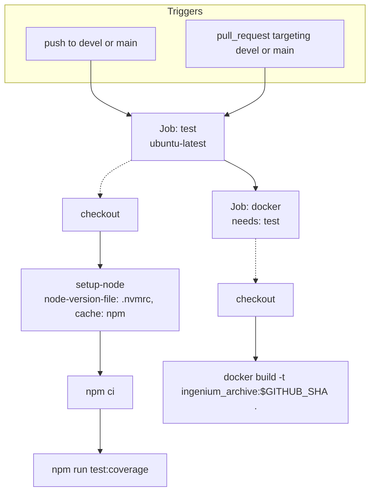

# CI/CD

GitHub Actions (`.github/workflows/ci.yml`) is the CI system present in the repository.

## GitHub Actions — `.github/workflows/ci.yml`

Key facts, all directly from `.github/workflows/ci.yml`:
- **Triggers**: `push` and `pull_request`, both restricted to `branches: [devel, main]`.
- **Concurrency**: `group: ${{ github.workflow }}-${{ github.ref }}`, `cancel-in-progress: true` — a new push to the same branch/PR cancels any still-running run for that ref.
- **Permissions**: `contents: read` only (no write permissions requested).
- **`test` job**: checks out the repo, sets up Node via `actions/setup-node@v5` using `node-version-file: '.nvmrc'` (so CI always matches the pinned local dev version) with npm caching enabled, runs `npm ci`, then `npm run test:coverage` — i.e. **CI enforces the same 100% coverage gate described in [Testing](./Testing.md)**; a coverage regression fails the build, not just the test assertions.
- **`docker` job**: depends on (`needs:`) the `test` job — the image is only built if tests pass — and runs `docker build -t ingenium_archive:${{ github.sha }} .`. The workflow does **not** push this image anywhere (no registry login/push step) — it only verifies the `Dockerfile` still builds. Publishing a runnable image is not part of this workflow.

There is no separate lint/format job because no lint/format tooling exists in the repository (see [Development](./Development.md#npm-scripts)).

## Releases/deployment

The repository does not contain a release workflow (no tag-triggered publish job, no changelog automation, no version-bump script). `package.json`'s `version` field (`1.0.0`) does not appear to be programmatically bumped anywhere in the repo. Deployment beyond `docker build` is **unknown/not documented** in this repository.
