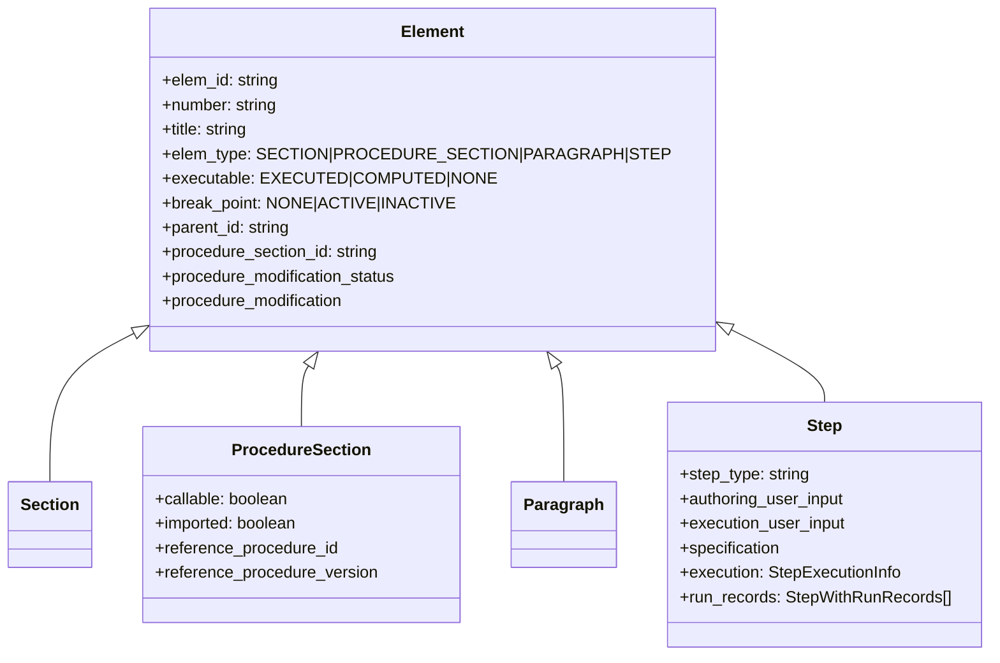
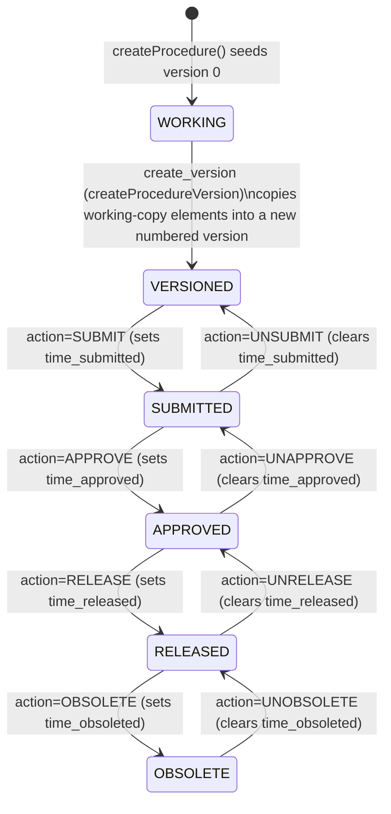

# Data Model

Source of truth: `definitions.js` (collection/graph names, enums), `api/base_funcs.js` (`init_db`, graph schemas), `api/swagger.yaml` (`definitions:` section — response/request schemas).

## ArangoDB collections and graphs

`definitions.js` declares two families of ArangoDB collections, matching the two root concepts of the system: **procedures** (authoring-time definitions) and **executions** (runtime instances of a procedure run against a venue).

| Constant | Collection name | Kind | Purpose |
|---|---|---|---|
| `VENUE_GROUP` | `venueGroup` | document | Groups of venues; a `Default` group is seeded on DB init |
| `VENUE` | `venue` | document | Test venues (`WSTS`, `Testbed`, `ATLO`, `Other` per `api/swagger.yaml` enum) with a `venue_status` |
| `EXECUTION` | `execution` | document | Root document of an execution (metadata: status, venue, timestamps, participants, transitions, …) |
| `ELEMENT` | `element` | document (graph vertex) | A node in an execution's element tree: `SECTION`, `PROCEDURE_SECTION`, `PARAGRAPH`, or `STEP` |
| `STEP_ORDER` | `stepOrder` | edge | Parent→child ordering edge between execution/element vertices; carries an `idx` (sibling order) |
| `REVISION` | `revision` | edge | Element→element edge (declared in `execution_graph`; used for element revision history) |
| `RUN_RECORD` | `runRecord` | edge | Step→run-record edge; used by `createNewRun` when a step is re-executed, chaining prior run snapshots |
| `EXECUTION_ID_GEN` | `execution_id_gen` | autoincrement | Key generator only; documents saved here produce sequential `_key`s used to build `execution_id` |
| `NEXT_RUN` | `nextRun` | edge | Part of the legacy `history_graph` (kept for restoring old DB backups — see below) |
| `PROCEDURE` | `procedure` | document | Root document of a procedure (title, author, `current_version`, `current_released_version`, …) |
| `PROCEDURE_ELEMENT` | `procedureElement` | document (graph vertex) | Same element shape as `element`, but scoped to a procedure version |
| `PROCEDURE_STEP_ORDER` | `procedureStepOrder` | edge | Parent→child ordering edge within a procedure version's element tree |
| `PROCEDURE_VERSION` | `procedureVersion` | document | One version of a procedure (see [Procedure version lifecycle](#procedure-version-lifecycle) below) |
| `HAS_VERSION` | `hasVersion` | edge | `procedure` → `procedureVersion` edge |
| `PROCEDURE_ID_GEN` | `procedure_id_gen` | autoincrement | Key generator for `procedure_id` (same pattern as `EXECUTION_ID_GEN`) |
| `PROCEDURE_LABEL` | `procedureLabel` | document | Labels that can be attached to procedures for organization/search |

## Named graphs

`api/base_funcs.js#init_db` creates three ArangoDB named graphs when the `ingenium` database is first created:

| Graph | Edge collections → vertex collections |
|---|---|
| `execution_graph` | `stepOrder` (`execution`,`element` → `element`), `revision` (`element` → `element`), `runRecord` (`element` → `element`) |
| `procedure_graph` | `procedureStepOrder` (`procedureVersion`,`procedureElement` → `procedureElement`), `hasVersion` (`procedure` → `procedureVersion`) |
| `history_graph` | `nextRun` (`execution`,`element` → `element`) — comment in code: *"Keep this to be able to restore old database backups"*. **Strong inference**: superseded by `revision`/`runRecord`; not exercised by any exported function seen in `api/base_funcs.js`, `api/node_funcs.js`, or `api/procedure_funcs.js`. |

All graph traversal in the codebase (`getStructure`, `getVerticesEdges`, cascade-delete queries in `deleteExecution`) uses AQL `GRAPH '<name>'` traversal, e.g.:

```aql
FOR vertex, edge IN 0..10000 OUTBOUND '<root_idd>' GRAPH 'execution_graph' OPTIONS {bfs: true}
  RETURN {v: vertex, e: edge}
```

`root_idd` is a fully qualified ArangoDB document handle such as `execution/clipper-ingenium-10001` or `element/<uuid>` — i.e. the traversal can start at the execution/procedure-version root **or at any element**, which is how "get the subtree under this section" is implemented without a separate code path.

## The element hierarchy

Both procedures and executions share one element type system (`ProcedureSimpleElement` / `ProcedureElement` in `api/swagger.yaml`):



- `elem_type` (`api/swagger.yaml` → `ProcedureSimpleElement.elem_type`): `SECTION`, `PROCEDURE_SECTION`, `PARAGRAPH`, `STEP`.
- A **`PROCEDURE_SECTION`** is a placeholder element that references another procedure (`reference_procedure_id`/`reference_procedure_version`) and can either be **imported** (its selected elements are copied in — `api/node_funcs.js#importProcedureSection`) or, if `callable` is set on its `execution_user_input`, invoked as a nested call instead of imported (`importProcedureSection` rejects with *"Should be called instead"* if `callable` is true — the calling mechanism itself lives outside this repository's exported functions and is **unknown/not documented** here).
- A **`STEP`** carries a `step_type` (e.g. `CUSTOM_SCRIPT`, `MANUAL_EIP`, `GDS_MANUAL`, `VERIFICATION_ITEM_STATUS` are the step types referenced by name in `api/base_funcs.js`/`api/node_funcs.js`; the full step-type catalog and each type's input/output schema is defined in `api/swagger.yaml` under the `Step`/`StepWithRunRecords` definitions and is intentionally not duplicated here — see `api/swagger.yaml`), plus `authoring_user_input` (author-time input template) and `execution_user_input` (execution-time input, seeded from `authoring_user_input` when a step is copied from a procedure into an execution — see [Data Flows](./Data-Flows.md)).
- Ordering within a parent is **not** stored on the element; it is derived from the `idx` field on the connecting `stepOrder`/`procedureStepOrder` edge and materialized into a dotted/hyphenated `number` string by `api/base_funcs.js#update_number` (e.g. top-level steps get `"1"`, `"2"`, …; children of section `"2"` get `"2-1"`, `"2-2"`; redline insertions get letter suffixes like `"2-1.a"` — see [Redlining](#redlining-procedure_modification_status) below).

## Procedure vs. execution: parallel but separate collections

Procedures and executions never share rows. When a procedure element is copied into an execution (or vice versa), `api/base_funcs.js#prepareElementForCopy` performs the copy: it generates a fresh `elem_id`/`_key`, drops the old `_id`, resets `conversations`, `break_point`, `tag_ids` (filtered to tags that still exist in the target), and step execution state, then pushes the transformed element and a new `stepOrder`/`procedureStepOrder` edge into `elems_to_add`/`edges_to_add` for a bulk `collection.import()`. This is the mechanism behind:
- Loading a procedure version into the working copy (`procedure_funcs.js#loadToWorkingCopy` / `_loadWorkingCopy`, not detailed here).
- Creating a new procedure version by copying the current working copy (`procedure_funcs.js#createProcedureVersion`).
- Importing a procedure section's elements into an execution (`node_funcs.js#importProcedureSection`).

## Procedure version lifecycle

A procedure (`procedure` collection) always has a **working copy** — `procedureVersion` with `version: 0` — plus zero or more **immutable numbered versions** created from that working copy. Status is derived (`procedure_funcs.js#deriveVersionStatus`) from which timestamp fields are set, in this precedence order:



Grounded in `api/procedure_funcs.js#updateProcedureVersionStatus` + `#deriveVersionStatus`:
- The `action` values accepted are exactly: `SUBMIT`, `UNSUBMIT`, `APPROVE`, `UNAPPROVE`, `RELEASE`, `UNRELEASE`, `OBSOLETE`, `UNOBSOLETE` (via `ProcedureVersionStatusInput`, `controllers/ProcedureVersionsService.js#update_version_status`).
- Status is **recomputed from timestamps** every time (`deriveVersionStatus`), not stored as an independent enum the caller sets directly — so, e.g., clearing `time_released` (`UNRELEASE`) while `time_approved` is still set naturally falls back to `APPROVED`, not `VERSIONED`.
- `deriveVersionStatus` precedence: `OBSOLETE` (if `time_obsoleted`) > `RELEASED` (if `time_released`) > `APPROVED` (if `time_approved`) > `SUBMITTED` (if `time_submitted`) > `VERSIONED` (default).
- `procedure.current_version` / `procedure.current_released_version` are maintained separately (`getProcedureCurrentVersion`/`getProcedureCurrentReleasedVersion`, called after every version mutation) — **strong inference**: these track "highest version number" and "highest released version number" respectively, used by API filters like `versioned`/`released` on `GET /procedures` (`api/procedure_funcs.js#getProcedures`).
- The working copy (`version: 0`) cannot be deleted (`deleteProcedureVersion` rejects unless `force=true`, which is only passed internally when import overwrites an existing version — see `importProcedureVersions`).

## Redlining (`procedure_modification_status`)

When an execution is run **for score** against a procedure (`run_for_score` flag, propagated recursively via `api/base_funcs.js#isInRunForScore`), elements copied from the procedure carry `procedure_modification_status: ORIGINAL`. A test conductor can then **redline/blueline** an original element:

| Status | Meaning |
|---|---|
| `NONE` | Element is not under run-for-score tracking |
| `ORIGINAL` | Unmodified element copied from the procedure |
| `MODIFIED` | The original element, now superseded by a `MODIFYING` element |
| `MODIFYING` | The new (redlined) element that replaces an `ORIGINAL`/previously-`MODIFIED` element |
| `MODIFYING_OLD` | A `MODIFYING` element that has itself been superseded by a newer `MODIFYING` element |
| `DELETED` | Original element redlined by deletion ("discarded") |
| `ADDED` | A new element inserted via redlining (has no corresponding original) |

Rules enforced in `api/node_funcs.js#modifyElement`/`#deleteElement`:
- Only elements with status `ORIGINAL` (and `run_for_score: true`) or `MODIFIED` may be modified again; `SECTION` elements can never be redlined.
- The execution must be in status `IDLE` to create or delete a redline (`Cannot modify/delete element when execution is not IDLE. First abort any running step`).
- A `MODIFIED`/`MODIFYING`/`MODIFYING_OLD`/`DELETED` element cannot be hard-deleted directly — it must be **discarded** (`execution_discard_element(s)`, `api/node_funcs.js#discardElements`) to revert the redline, except that a redlined `SECTION` (internally `ADDED`) is deletable directly, per an explicit code comment in `node_funcs.js#deleteElement`.
- Numbering for redlined subtrees uses a dotted-letter scheme distinct from normal siblings (`api/base_funcs.js#update_number`): `MODIFYING`/`MODIFYING_OLD` children get `<reference_number>.a`, `.b`, … ; `ADDED` children get `<reference_number>.1`, `.2`, ….

See [Data Flows](./Data-Flows.md#redline-a-step-modifyelement) for the end-to-end redline flow.

## Enums shared across layers (`definitions.js`)

```js
ProcedureModificationStatus = { NONE, ORIGINAL, MODIFIED, MODIFYING, MODIFYING_OLD, DELETED, ADDED }
ProcedureModificationType   = { NONE, REDLINE, BLUELINE }
CommentType                 = { COMMENT, ACTIVITY_REPORT_COMMENT, DATA_REVIEW_COMMENT }
CommentStatus                = { UNRESOLVED, RESOLVED }
```

`ProcedureModificationType` (REDLINE vs. BLUELINE) is declared in `definitions.js` but the repository does not document the functional difference between the two beyond the name — **unknown / not documented**.

## ID generation

Both `execution_id` and `procedure_id` are generated the same way: save an empty document into an `autoincrement`-keyed collection (`execution_id_gen` / `procedure_id_gen`, offset `10001`), take the returned `_key`, and prefix it with a configurable string:

```text
execution_id  = config.execution_id_prefix + <autoincrement key>   # default prefix: "clipper-ingenium-"
procedure_id  = config.procedure_id_prefix + <autoincrement key>   # default prefix: "clipper-procedure-"
```

See [Configuration](./Configuration.md) for how the prefixes are configured. All other IDs (`elem_id`, `version_id`, `venue_group_id`, `label_id`, `tag_id`, `conversation_id`, `comment_id`, `file_id`) are UUIDv4 (`uuid.v4()`), generated at write time and used as the ArangoDB `_key` for that document.
