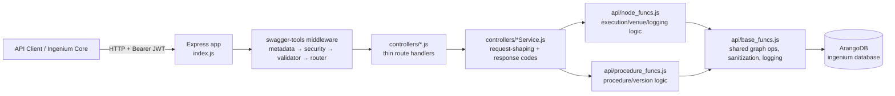

# Ingenium Archive — DeepWiki

Technical knowledge base for the `Ingenium_Archive` service (repository name: `archive`, on-disk workspace name: `Ingenium/archive`). This wiki documents **how the system works internally** — architecture, data model, control/data flow, configuration, testing, and CI/CD.

For "what is this and how do I get started", see the repository [`README.md`](../README.md). This wiki does not repeat that content; it goes one level deeper into the implementation.

> **Documentation conventions used throughout this wiki**
> - Statements are grounded in the current code unless marked otherwise.
> - **Strong inference** marks conclusions drawn from code structure/naming where the repository does not state them explicitly.
> - **Unknown / not documented** marks anything the repository does not establish (rationale, external SLAs, etc.). These are called out explicitly rather than guessed at.

## What this service is

Ingenium Archive is a Node.js/Express REST API (`/api/v5`) backed by ArangoDB. It is the persistence and API layer for **procedures** (reusable, versioned test-procedure definitions) and **executions** (live/historical runs of a procedure against a test **venue**). Both procedures and executions are modeled as **graphs** of typed elements (sections, procedure sections, paragraphs, steps) rather than flat rows — see [Data Model](./Data-Model.md).

The HTTP layer is generated/driven by a Swagger 2.0 contract (`api/swagger.yaml`) interpreted at runtime by `swagger-tools`; business logic lives in `controllers/*Service.js` and the shared `api/*.js` modules, not in hand-written route definitions. See [Architecture](./Architecture.md).

## Wiki map

| Page | Answers |
|---|---|
| [Architecture](./Architecture.md) | How is the codebase organized? How does a request flow from HTTP to ArangoDB and back? |
| [Data Model](./Data-Model.md) | What collections/graphs exist in ArangoDB? What is an "element"? How do procedures relate to executions? |
| [Core Components](./Core-Components.md) | What do `api/base_funcs.js`, `api/node_funcs.js`, `api/procedure_funcs.js` and the `controllers/*Service.js` files actually do? |
| [API Reference](./API-Reference.md) | What resources/operations exist, what scopes do they need, how do I call them? |
| [Data Flows](./Data-Flows.md) | End-to-end walkthroughs: creating an execution, adding a step, redlining, procedure versioning/release, deletion cascades. |
| [Configuration](./Configuration.md) | What environment variables exist, what do they default to, where are they read? |
| [Development](./Development.md) | How do I run this locally, with or without Docker? |
| [Testing](./Testing.md) | How is the Jest suite structured? How is 100% coverage enforced? |
| [CI/CD](./CI-CD.md) | What does `.github/workflows/ci.yml` actually do? |
| [Security](./Security.md) | How is a request authenticated/authorized? What is and isn't covered? |
| [Error Handling & Logging](./Error-Handling-and-Logging.md) | How are errors shaped and returned? How does logging work? |
| [Extending the System](./Extending.md) | How do I add a new resource/endpoint/test safely? |
| [Troubleshooting](./Troubleshooting.md) | What documented failure modes and gotchas exist? |

## Technology stack (observed)

| Concern | Technology | Where |
|---|---|---|
| Runtime | Node.js `>=22.0.0 <23` (pinned `22.23.4`) | `.nvmrc`, `package.json` `engines` |
| HTTP framework | Express 4.x | `index.js` |
| API contract / routing | `swagger-tools` 0.10.4 interpreting `api/swagger.yaml` (Swagger 2.0) | `index.js` |
| Database | ArangoDB, via `arangojs` 7.8.0 | `api/base_funcs.js`, `config.js` |
| Auth | `jsonwebtoken` (RS256 verification) | `index.js`, `api/base_funcs.js`, `api/node_funcs.js` |
| Logging | `winston`, custom levels, JSON output | `api/base_funcs.js` |
| Testing | `jest` 29.x | `tests/unit/**`, `jest.config.js` |
| Containerization | Docker (`Dockerfile`) | repo root |
| CI | GitHub Actions (`.github/workflows/ci.yml`) | repo root |

## High-level architecture

See [Architecture](./Architecture.md) for the request lifecycle in detail, including where JWT verification and swagger schema validation happen.
