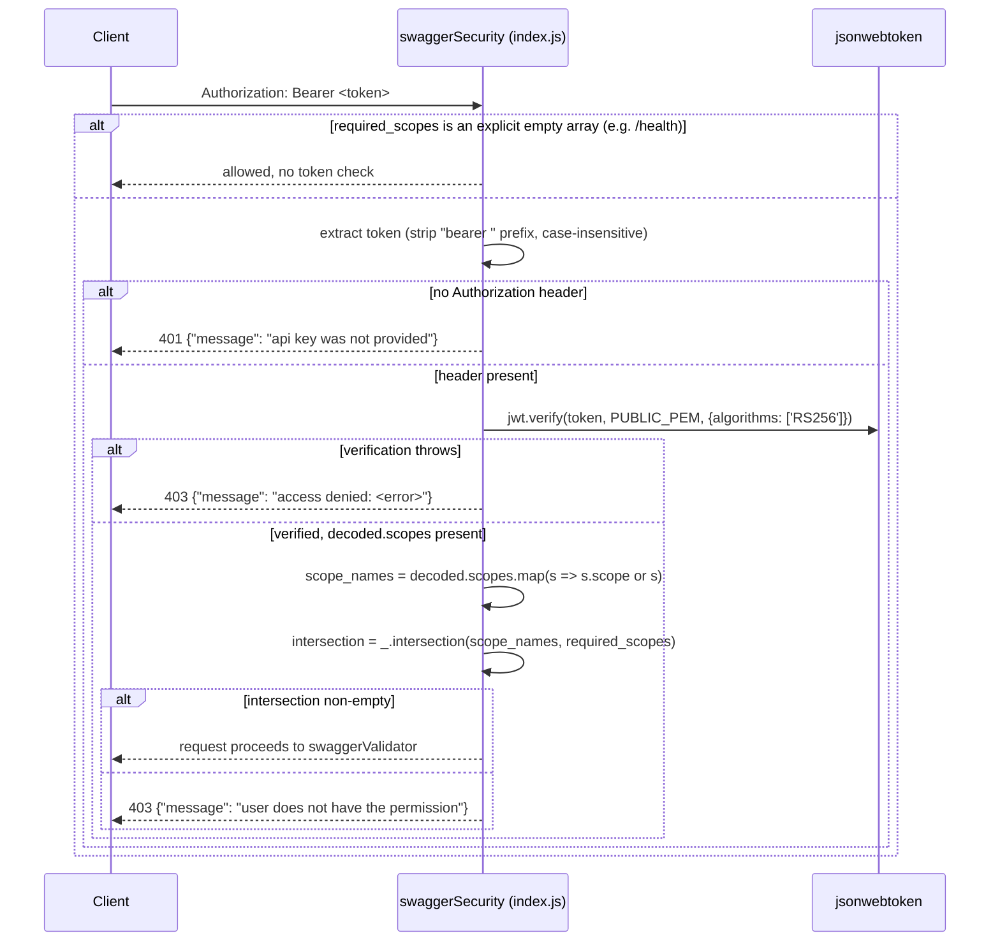

# Security

This page documents security-relevant mechanisms **as implemented**. It does not assert the system is secure overall — only what exists and what is observably absent.

## Authentication: JWT bearer tokens (RS256)

Implemented entirely in `index.js`'s `swaggerSecurity` middleware, registered as the `UserSecurity` handler referenced by `api/swagger.yaml`'s `securityDefinitions.UserSecurity`:

Grounded details:
- The **only** accepted algorithm is `RS256` (`algorithms: ['RS256']` passed explicitly to `jwt.verify`) — the public key comes from the `PUBLIC_PEM` environment variable (see [Configuration](./Configuration.md)); there is no key rotation/JWKS-fetching logic, no issuer/audience validation call visible in `index.js`.
- `decoded['scopes']` is expected to be an array whose entries are either a string or an object with a `.scope` property (`scope.hasOwnProperty('scope') ? scope.scope : scope`) — the codebase tolerates both shapes but does not document which token issuer produces which shape.
- Scope matching is a **set intersection**, not exact match — a token needs *any one* of the operation's `required_scopes`, not all of them.
- **Every** operation in `api/swagger.yaml` declares a `security:` block except where a resource intentionally widens or narrows it (see [API Reference](./API-Reference.md#resources-and-their-controller-pair) for the per-resource scope table); `/health` is the only operation with an explicitly empty scope list, meaning it is the only unauthenticated endpoint.
- The comment block in `api/swagger.yaml`'s `securityDefinitions` explains a deliberate modeling choice: *"this service uses JWT and the type should be apiKey. But apiKey type of swagger does not support scopes... Instead use oauth2 as the type so that we can define scopes in swagger."* This is a **documented rationale** — the `oauth2`/`implicit` flow declared in the spec does not mean this service implements an OAuth2 authorization-code/implicit flow; it is a Swagger 2.0 modeling workaround to get scope-checking middleware from `swagger-tools`.

## Authorization: scopes

Ten scopes are declared (`api/swagger.yaml securityDefinitions.UserSecurity.scopes`): `admin`, `execute:wsts`, `execute:testbed`, `execute:sit`, `execute:other`, `config_mgmt`, `imcm`, `test_lead`, `author`, `basic`. Their intended meaning (per the spec's inline descriptions) and where each is actually required is summarized in [API Reference](./API-Reference.md). Notable, code-verifiable authorization rules:

- Structural mutations on an execution (`add/move/copy/modify/discard` element, step/status updates) require one of the four `execute:*` scopes.
- Comments/conversations on execution elements require only `basic`.
- Authoring operations on procedures (element CRUD, tags, versions, working-copy reload) require `author`.
- Procedure-version status transitions (submit/approve/release/obsolete) require `author`, `imcm`, `admin`, **or** `test_lead` — any one of the four, not a specific role per action (e.g. the same 4-scope set can both submit *and* release a version; the swagger spec does not encode a stricter per-action role split).
- Venue/venue-group CRUD requires `admin`, except `set_venue_status`, which deliberately also allows `execute:*` scopes — with an explicit code comment explaining why (see [API Reference](./API-Reference.md#resources-and-their-controller-pair)).
- The top-level default `security:` block (`admin, execute:wsts, execute:testbed, execute:sit, execute:other, config_mgmt, imcm, test_lead, author, basic` — i.e. *any* scope) applies to operations that don't declare their own `security:` override, which in practice covers most read/list (`GET`) endpoints.

## What is *not* covered (gaps observed in the repository)

- **No rate limiting** anywhere in `index.js` or its middleware chain.
- **No input sanitization against injection** beyond what `swaggerValidator()` enforces via the JSON-schema types/enums in `api/swagger.yaml`; several AQL query builders (`api/procedure_funcs.js#getProcedures`, `api/node_funcs.js#getVenues`, and similarly-shaped functions) interpolate filter values directly into AQL template strings (e.g. `` `FILTER LIKE(doc.title, "%${title}%", true)` ``) rather than using bind parameters for those particular filters. **Strong inference, not confirmed by a security audit in this repository**: because these values pass through `swaggerValidator()`'s type checking first (most are typed `string`/enum), and ArangoDB's AQL string literals do not permit statement-level injection the way SQL does, the practical risk profile differs from classic SQL injection — but this repository does not contain any documentation, test, or code comment asserting this pattern is safe, and it has not been formally reviewed here. Flagging it as an area worth a dedicated security review rather than asserting a verdict either way.
- **No CORS configuration** visible in `index.js` — cross-origin behavior is whatever Express's defaults produce (effectively none configured).
- **No secrets management integration** — `PUBLIC_PEM`, `ARANGO_ROOT_PASSWORD` are plain environment variables; there is no Vault/KMS integration in this repository.
- **File upload size limits**: `body-parser` is configured with generous limits (`bodyParser.json({limit: "500mb"})`, `bodyParser.urlencoded({limit: "5mb", ..., parameterLimit: 5000})`) in `index.js` — there is no additional virus-scanning, content-type sniffing, or per-file size cap visible for the `multipart/form-data` file-upload operations beyond what `swagger-tools`/`swaggerValidator()` enforces from the spec.
- **No audit log/immutable history of who changed what**, beyond `execution.transitions[]` (status changes only, capturing `user_name`, `from_status`, `to_status`, `comment`, `time_updated`) and the request-level Winston log line emitted by the `express-interceptor` in `index.js` (see [Error Handling & Logging](./Error-Handling-and-Logging.md)) — the latter is operational logging, not a tamper-evident audit trail.

None of the above gaps are called out in the repository as known/accepted risks (no `SECURITY.md`, no risk-acceptance doc) — they are simply absent from the code; do not present them as "intentionally out of scope" without further confirmation from the maintainers.
